 

  

###

###

<h2 data-importer="text" align="left">About Me</h2>

###

<h5 data-importer="text" align="center">💻 SRE/DevOps engineer 🐛 Creating bugs since 2004!!!  📜 I'm learning PyTorch 🎯 My current goal is to get more AWS certs</h5>

###

<h2 data-importer="text" align="left">Tools</h2>

###

  
  
  
  
  
  
  
  
  
  
  
  
  
  
  
  
  
  
  
  
  
  
  
  
  
  
  
  
  
  
  
  
  
  
  

###

<h2 data-importer="text" align="left">Stats</h2>

###

  
  

###
<h2 data-importer="text" align="left">More Stats</h2>
###

  

###

  
  
  

###

<picture data-importer="pacman">
  <source media="(prefers-color-scheme: dark)" srcset="https://raw.githubusercontent.com/JanetHase/JanetHase/pacman-output/pacman-contribution-graph-dark.svg?game=pacman">
  <source media="(prefers-color-scheme: light)" srcset="https://raw.githubusercontent.com/JanetHase/JanetHase/pacman-output/pacman-contribution-graph.svg?game=pacman">
  
</picture>

